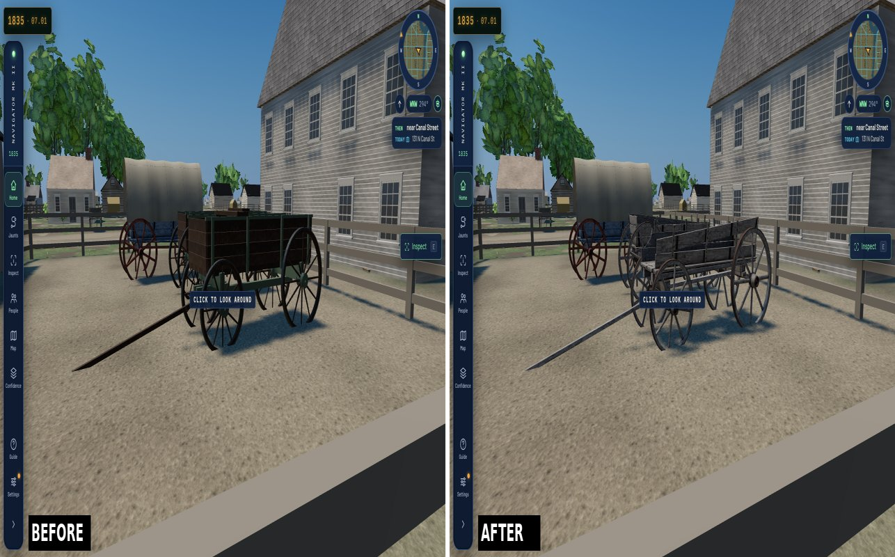
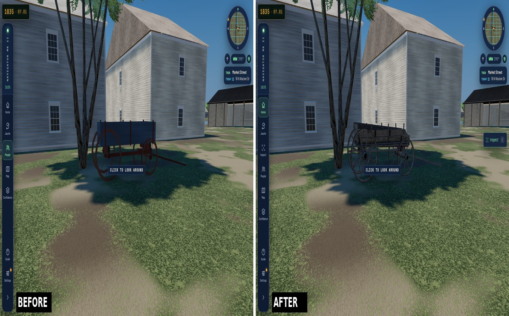
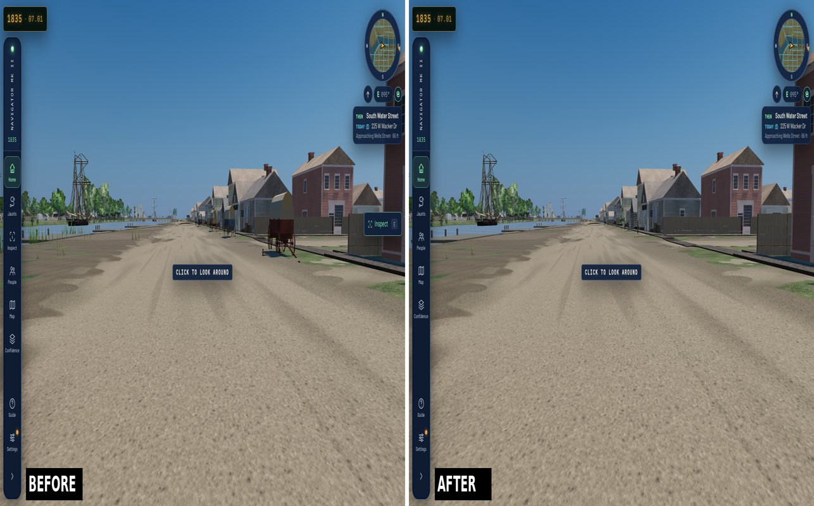

# 1835 parked wagons: before and after (T-3558)

Left: before (the procedural yard wagons). Right: after (the photographic farm-box wagon, or nothing where a stand is retired).

## Western Hotel wagon yard

## Market Street verge

## South Water Street: the covered-wagon train is retired

