# T-3558: wagons and Brougham, before and after (2026-11-17)

Pictures for kevinrhaas/chicago PR 2140.

## Brougham V20 against its 1893 plate

Plate 0095 at its solved camera, V19 (before), V20 (after):

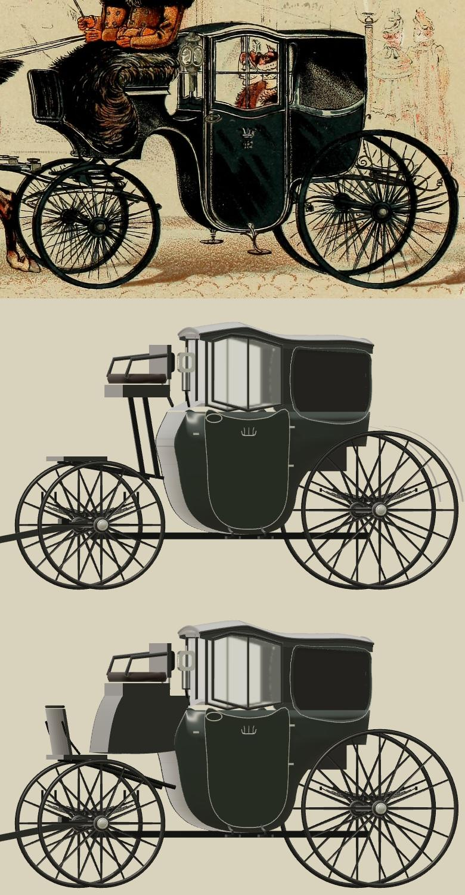

1904 town, desktop, before | after:

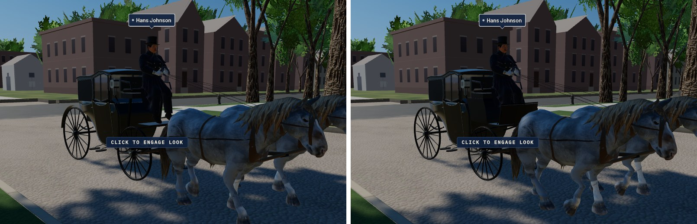

1904 town, phone, before | after:

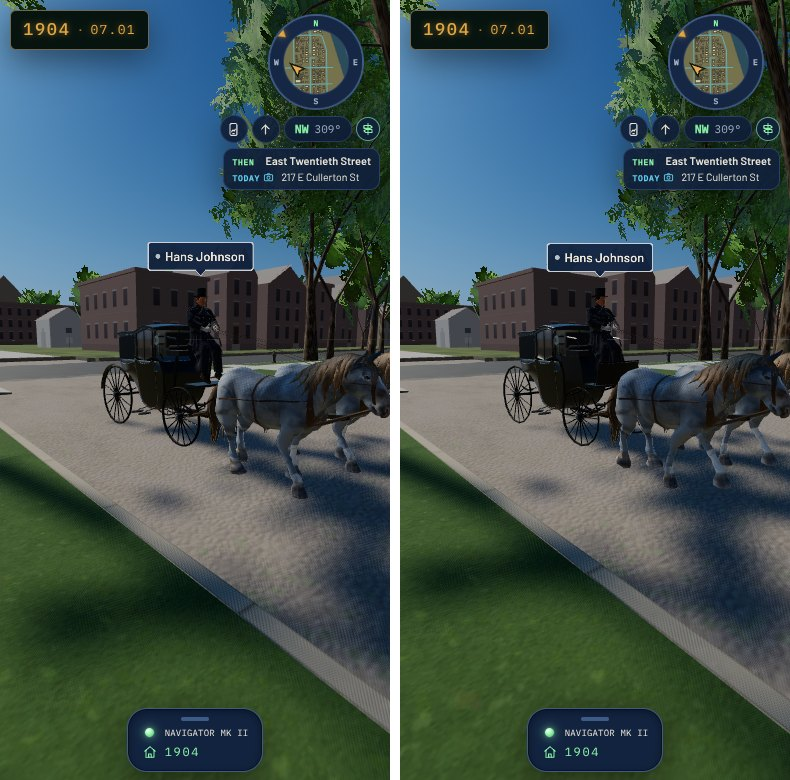

Near, mid and far levels:

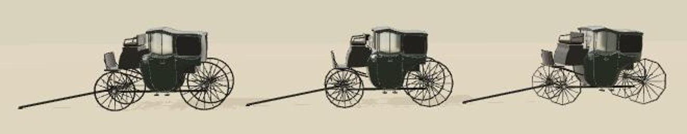

## Covered wagons v2

Western Hotel wagon, v1 above, v2 below:

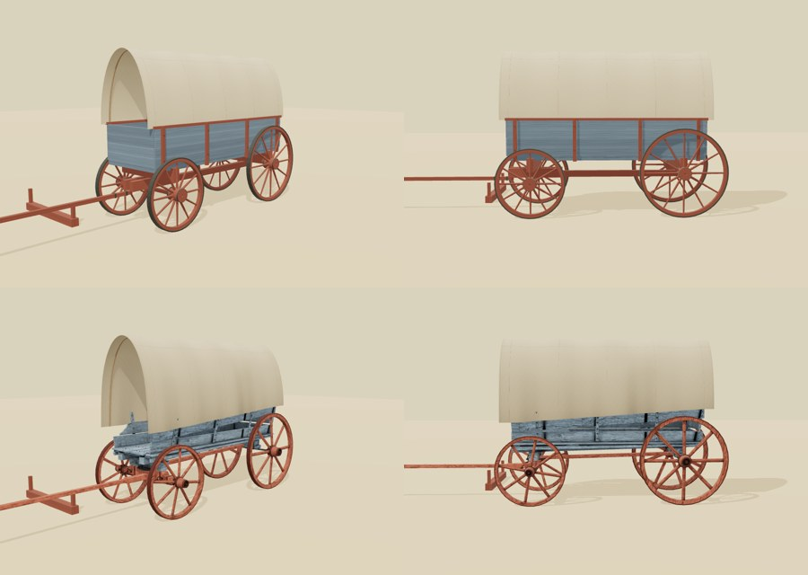

Wolf Point wagon, v1 above, v2 below:

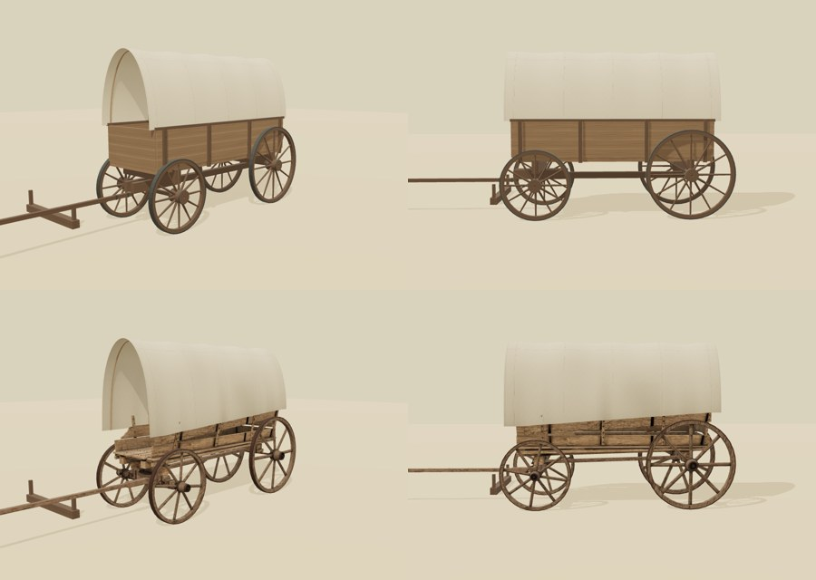

1835 town, before | after: desktop Western Hotel, desktop Wolf Point, phone Western Hotel:

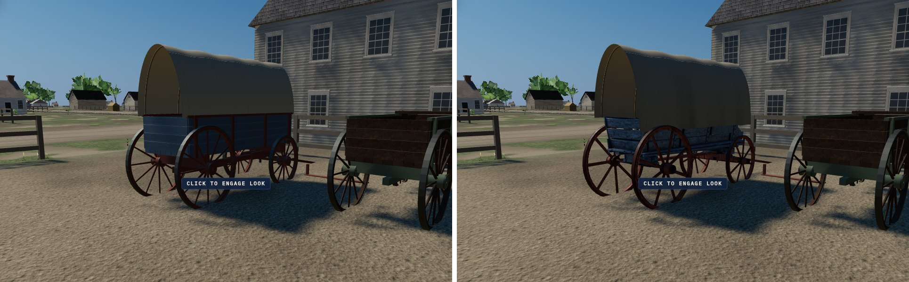

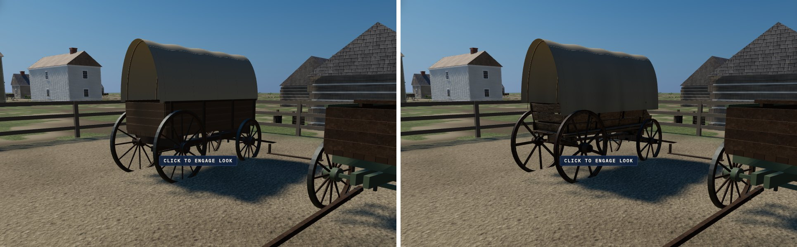

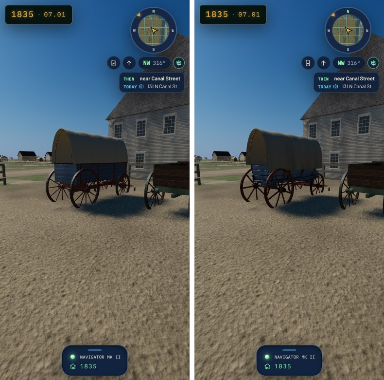

## Farm box qualified

Beside Wild's 1835 Third and Vine and the Buffalo Eagle Tavern print:

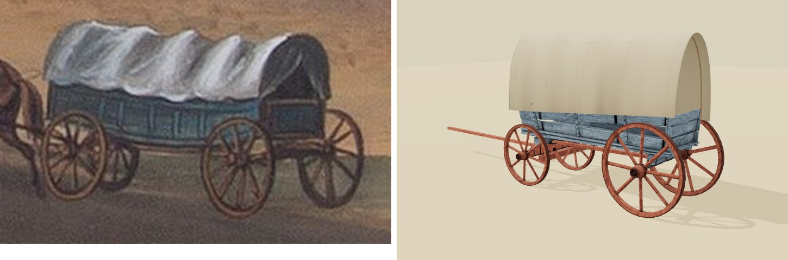

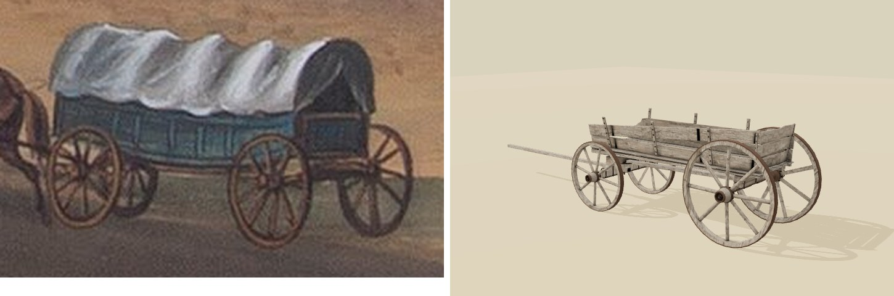

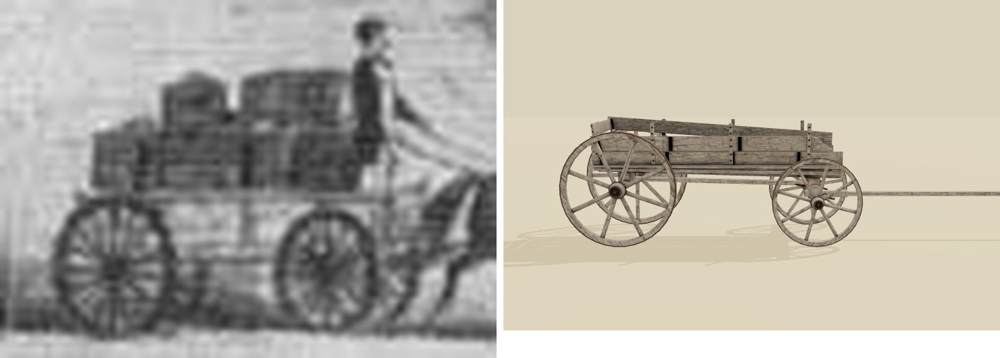

1812, desktop | phone:

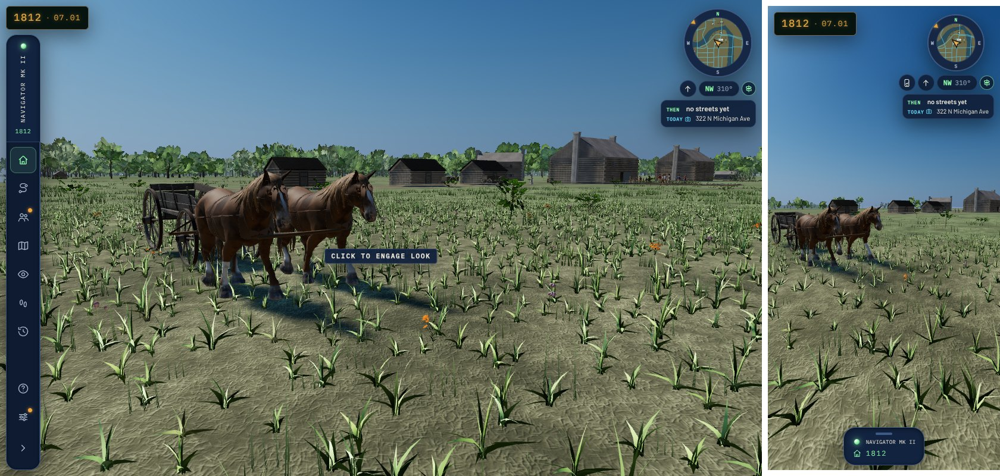

## Hans Johnson's people-match, reshot on V20

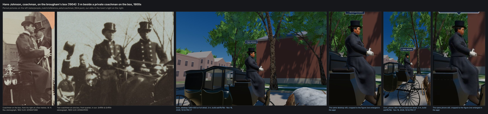
