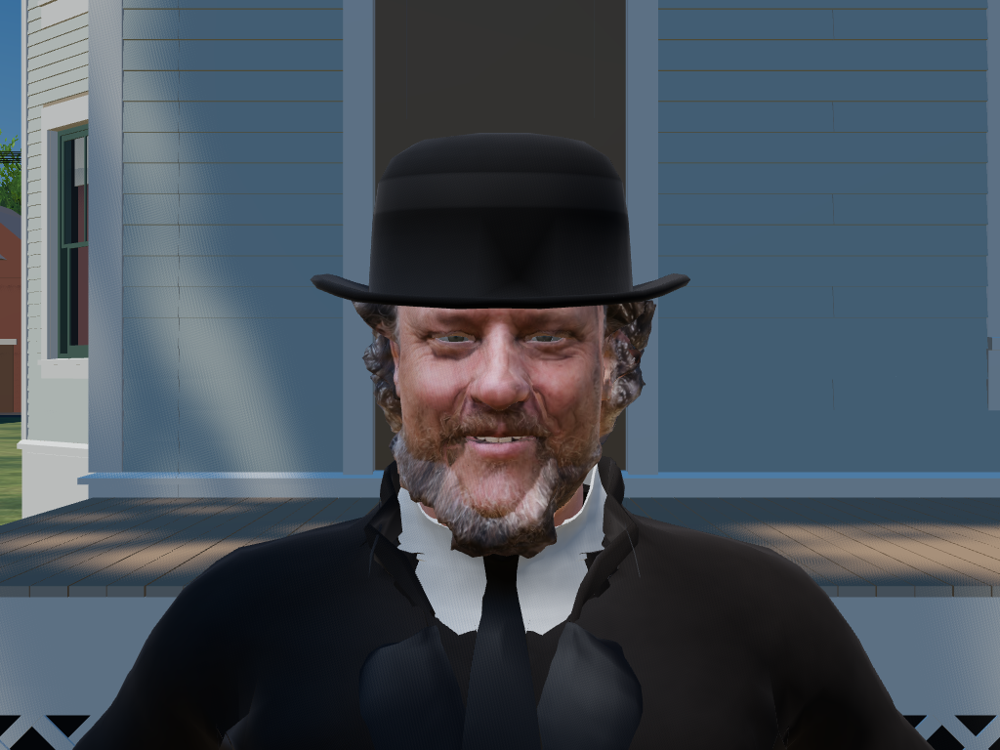
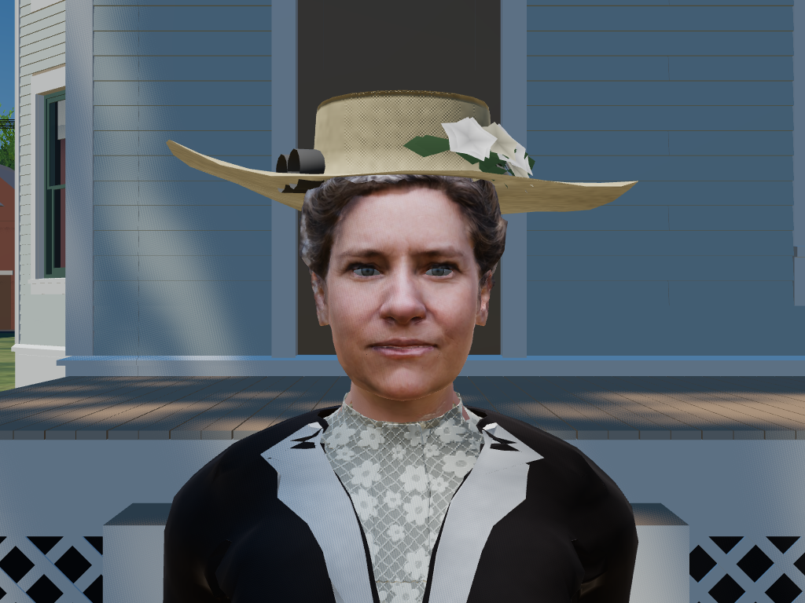
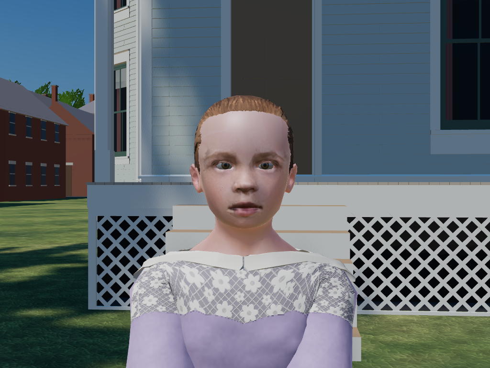
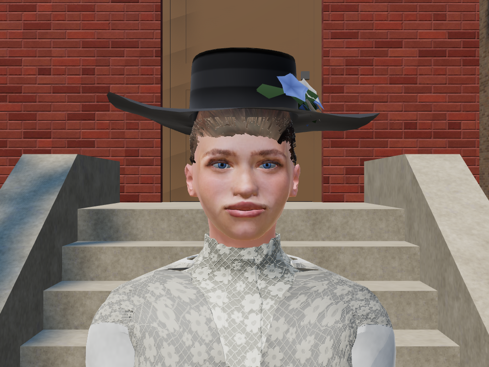
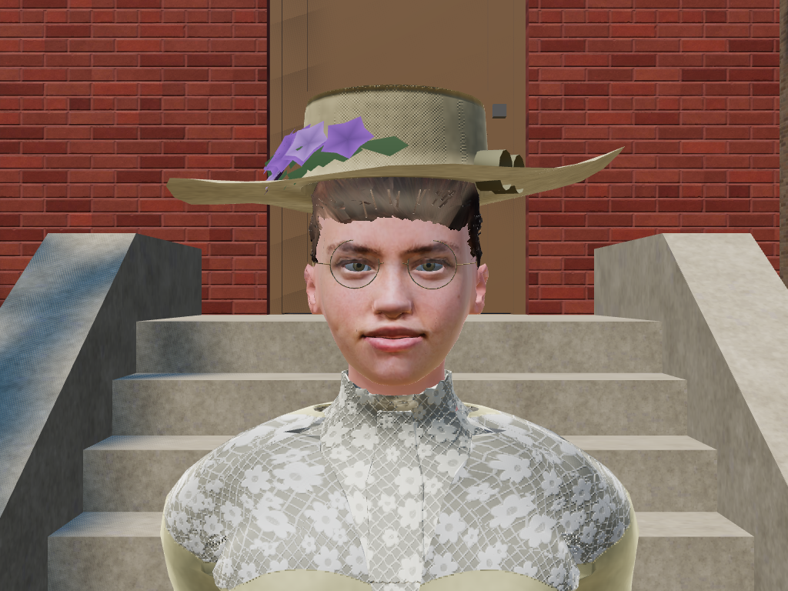
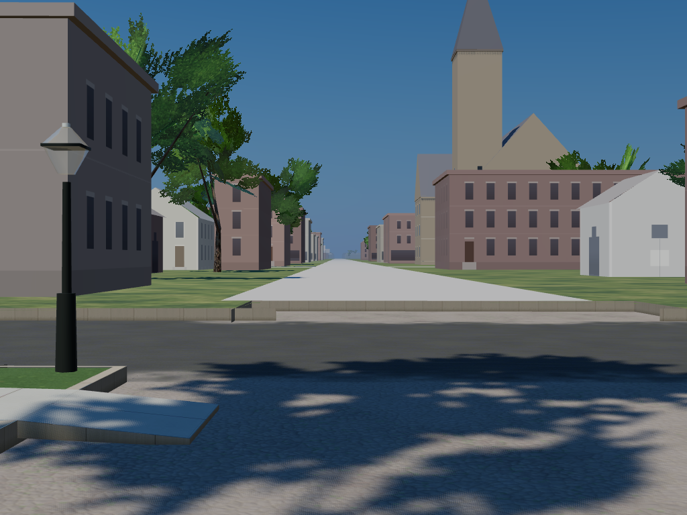

# T-3836: eyes in the actual app

Eye fit, gaze and optics built on merged photo/hair PR #2371 (dev `adf03372d897af48065d9354d23ad7294ee8ec2b`).
Frozen release candidate: `2efc8838536f373cc1dbd72d350885d52b3741a7`. Imported JavaScript hashes, original geometry
counts, body-skeleton sharing and the ten image hashes are in [native-views.json](native-views.json).
The eye change has not yet been merged to dev. Complete release qualification is in progress.

The original image capture tree is `a51f553692106c23211029618310e6b681439944`; those
receipts remain unchanged. The [canonical rebuild proof](canonical-library-rebuild.json)
records the later refresh of three renderer input hashes and two runtime review hashes.
All 530 generated files were compared: images, scalps, recipes and face parameters are
byte identical. The renderer modules are identical too, and both runtime catalogs retain
identical drawing parameters. The source patch and release candidate include that refresh.
Full native qualification is being repeated on the corrected source.

These are original published-app renders in Chromium SwiftShader, with the camera framed
for review and other figures hidden. The app's materials, lights and native detail tiers
are retained. The untimed boot's onscreen draws are held; actual offscreen and review
renders use the native renderer. One interrupted asset load during a concurrent validation
publish was retried after publishing completed; the receipt records that interruption.

## Front views

| William Grey, Balanced | Sarah Grey, Balanced |
|---|---|
|  |  |

| Elizabeth Grey, Light | Dorothy Sterling, Full |
|---|---|
|  |  |

| Alice May Stirling, Balanced | Hans Johnson, generic library face, Balanced |
|---|---|
|  |  |

Angled views: [William](william-balanced-oblique-in-app-face.png),
[Sarah](sarah-balanced-oblique-in-app-face.png), [Dorothy](dorothy-full-oblique-in-app-face.png).
[Elizabeth at Balanced](elizabeth-balanced-front-in-app-face.png).

## Scope and measured cost

Eyes turn about their fitted globe centres; authored animation position tracks cannot
undo that fit. Globes seat within their fitted lids (at most 4 mm vertically). Gaze begins
between the eyes and converges smoothly on nearby visitors. Original head fits, source
portraits and iris hues are retained. Legacy Grey iris exposure follows its photographic
whites. Iris/pupil normals form one spherical corneal curve. Flat recorded iris colours
receive filtered radial detail; existing iris maps retain their own fibres.

| Native tier | Total private ocular geometry buffers in these views |
|---|---:|
| Light | 8,088 bytes |
| Balanced | 14,796 bytes |
| Full | 30,108 bytes |

These are total private ocular buffers, not an added-texture estimate. Vertex and triangle
counts are unchanged, the eyes share the body skeleton, and this pass adds no image, light
or draw pass. The existing one-page photographic detail limit holds. Physical-GPU crowd
frame rate remains unmeasured; these stills do not claim photographic perfection.

Targeted checks: [skin and optics](skin-final-targeted.log), [life and binocular focus](life-final-targeted.log),
[photo-library rollout](rollout-final-targeted.log). [Source patch](eye-source.patch.gz).

## Visible limits in this pass

William's photographed squint remains narrow, with a thin lower sclera strip still visible
from the front. Close views retain the source photograph's lid shadows and limited texture
resolution. Reduced detail levels retain angular pupil outlines in extreme close-ups.
The source portraits, head proportions and original iris maps are preserved; the images
show an improvement in eye fit and focus, not a finished photographic-quality face.
