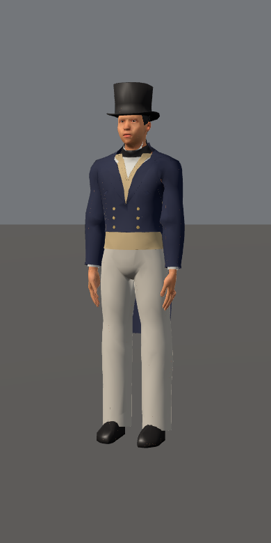
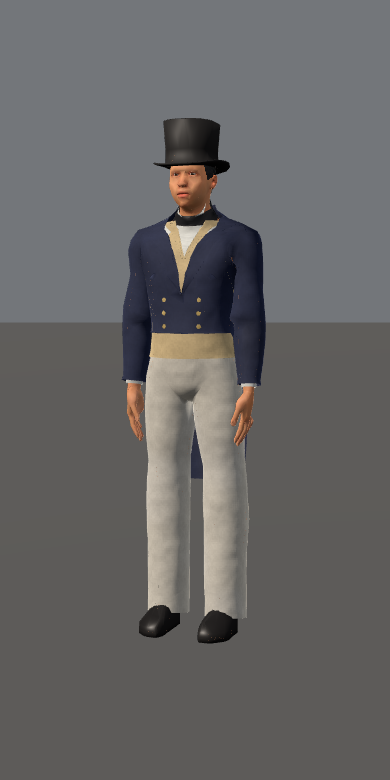

# Actual clothing-loader review, PR1904

App source: a64f26fa2fc3e05dd39cd8e55df5384646786d7b, exactTREE0c2fe214e0c41f127282f82b04b3754279baf526. [PR1904](https://github.com/kevinrhaas/chicago/pull/1904) remains open; this packet claims no DEV merge.

Six actual HumanActor studio cells pass: source and published assets on desktop/phone, plus paired source-desktop and published-phone baselines. Each draws adopted Otis and Peck standing and walking:24 actual PNGs. Real compiled garment shader hooks are observed; no manual cloth patch is applied by the probe. Baseline serves only the earlier unchanged loader module over the same current assets and other modules. This is controlled studio evidence, not a whole-town or photographic-quality acceptance.

Independent review accepts the incremental cloth detail while preserving silhouettes, clothing styles and palettes. Geometry, draw, triangle and texture inventories match before/after. Otis's source face and shoe-interior pixels match exactly; their pre-existing fine pattern is not caused by this change. No new obvious clipping is seen in the sampled walking stills. All actors release, cleanup completes and original caps/resource guards remain.

| Peck, published phone, before | After |
|---|---|
|  |  |

The complete original four-part source gate passed1267 checks/408 self-tests on the committedTREE; repaired checkout-fixture failures remain preserved in the earlier checkpoint. Committed-HEAD preflight passed. Hosted CI and actual Blender study outputs are separate pending results. No complete human-library, garment-fit or photographic acceptance is claimed.
