# Current people in the app — T-3762

Native app captures from frozen candidate tree `f084f57a5e781b90b05666d7d30a55e26bdd2c54`. **Dev deployment is pending verification.** The eight front faces and six full figures use the published app’s assigned people, period clothes, materials and lighting. The camera is framed for review; no material injection or image generation was used. [Capture receipt](native-surface-review/receipt.json) binds the images to the served renderer and catalogs.

The close-up correction keeps the frontal cap above the skin and gives compressed hair meshes usable normals. Photo eye whites retain their measured tone. Children keep their existing head/body/eye geometry. These are software-rendered stills; real GPU FPS remains unmeasured.

## William L. Grey

Original owner-chosen fitted head, photographic skin, hair and beard, retained in the current app. [Mapping verification](grey-original-mappings/receipt.json).

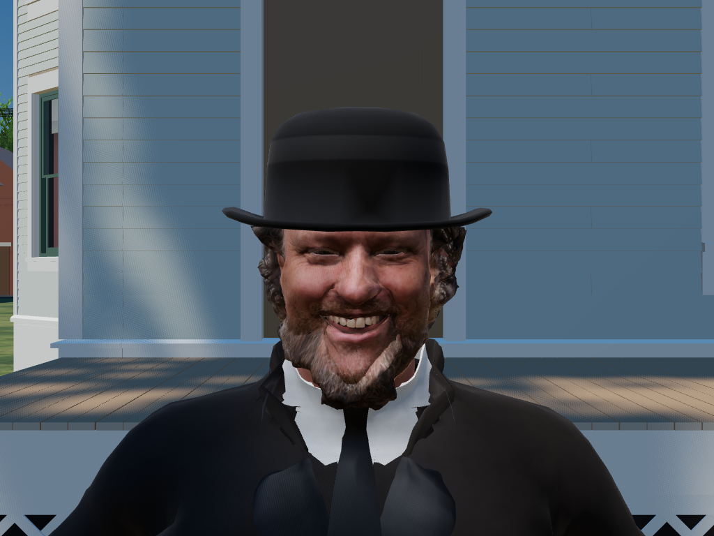

## Sarah Grey (Mrs. W. L. Grey)

Original owner-chosen fitted head, photographic skin and hair, retained in the current app. Both Grey mappings keep their original fitted-head, skin-recipe and image bytes and take precedence over generic faces.

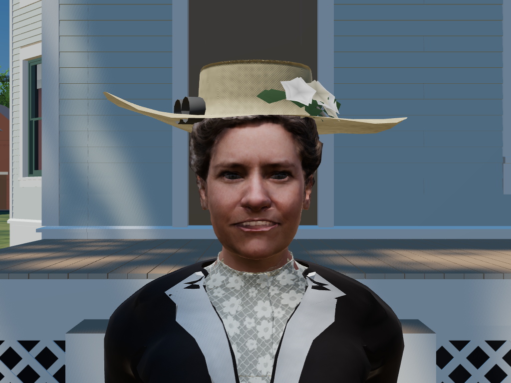

## Walter C. Grey

Reconstructed library face; no individual archival likeness claimed

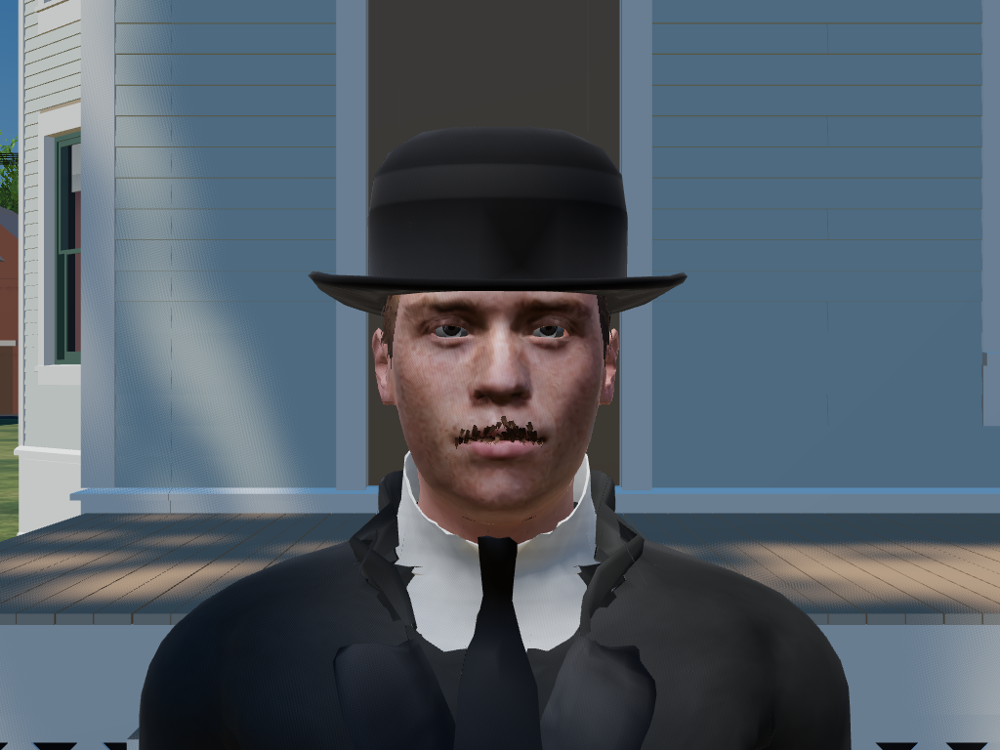

## Florence Grey

Reconstructed library face; no individual archival likeness claimed

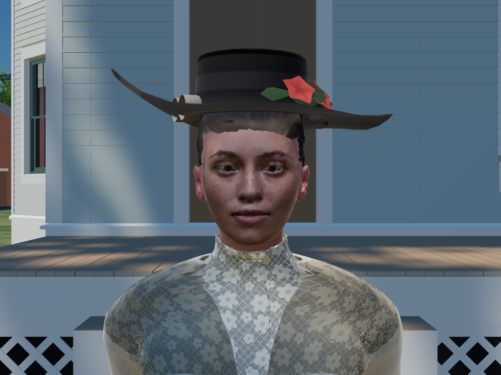

## Elizabeth W. Grey

Reconstructed library face; no individual archival likeness claimed

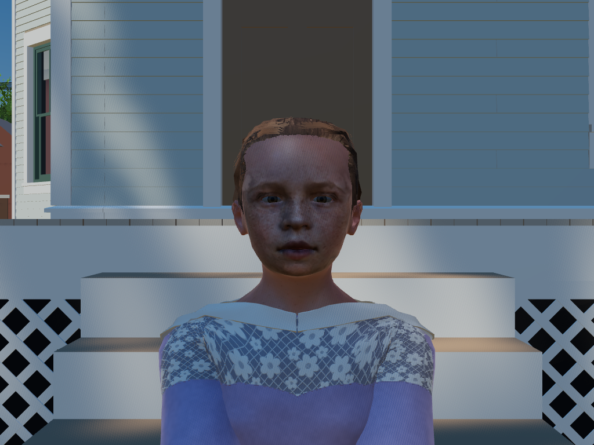

## Henry W. Young

Reconstructed library face; no individual archival likeness claimed

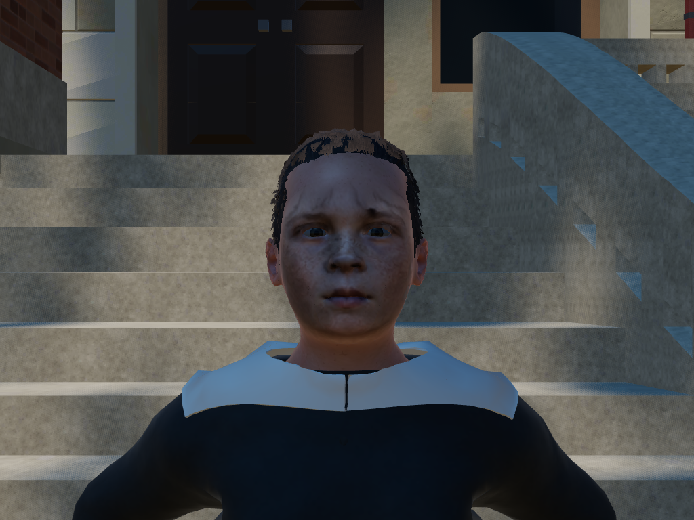

## Dorothy Sterling

Owner-chosen period reference model

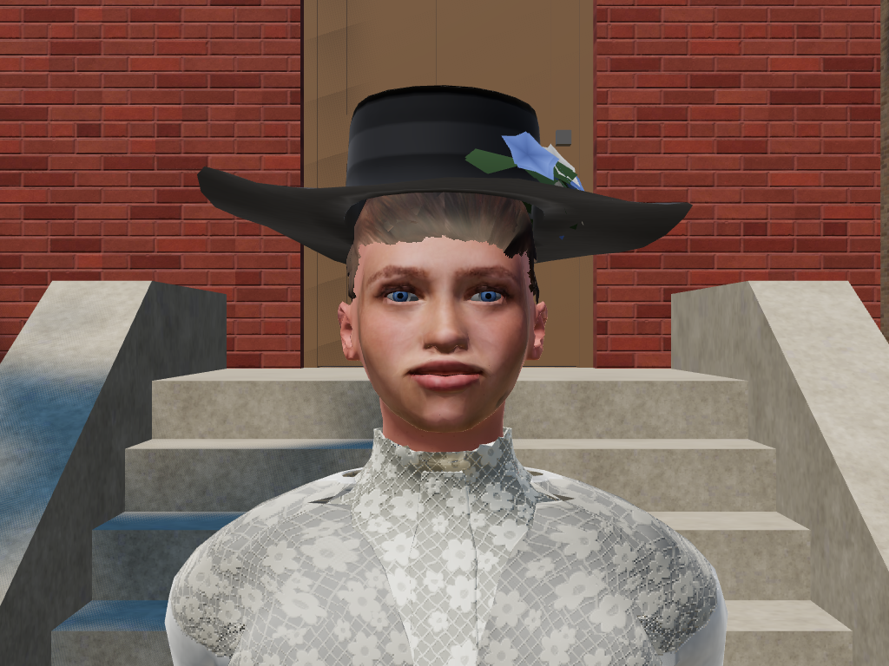

## Alice May Stirling

Owner-chosen period reference model

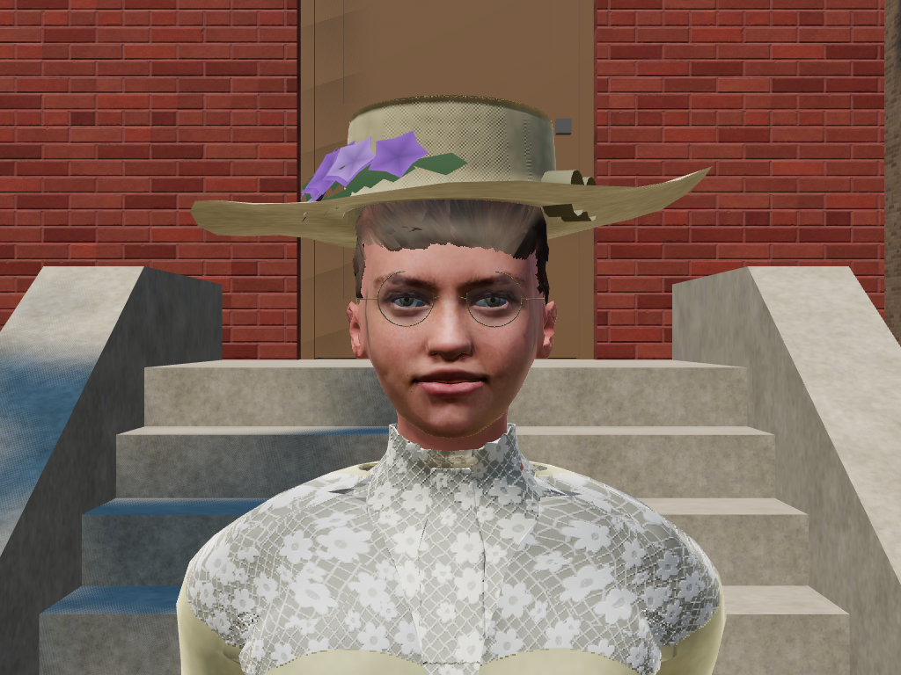

## Full figures

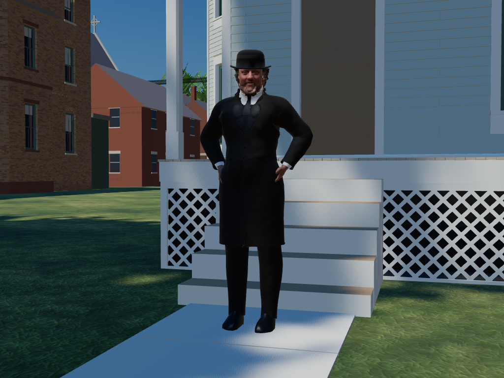

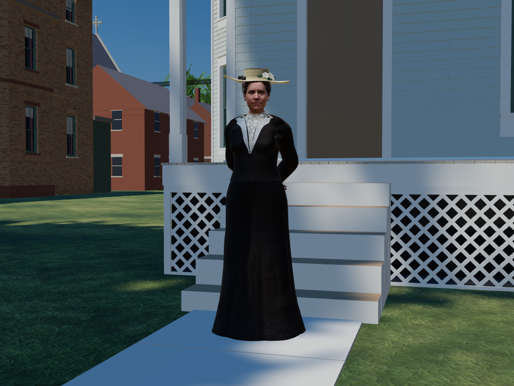

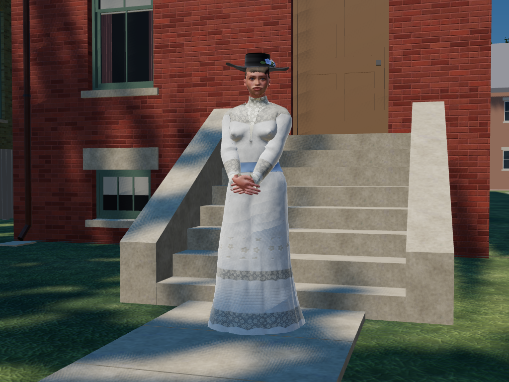

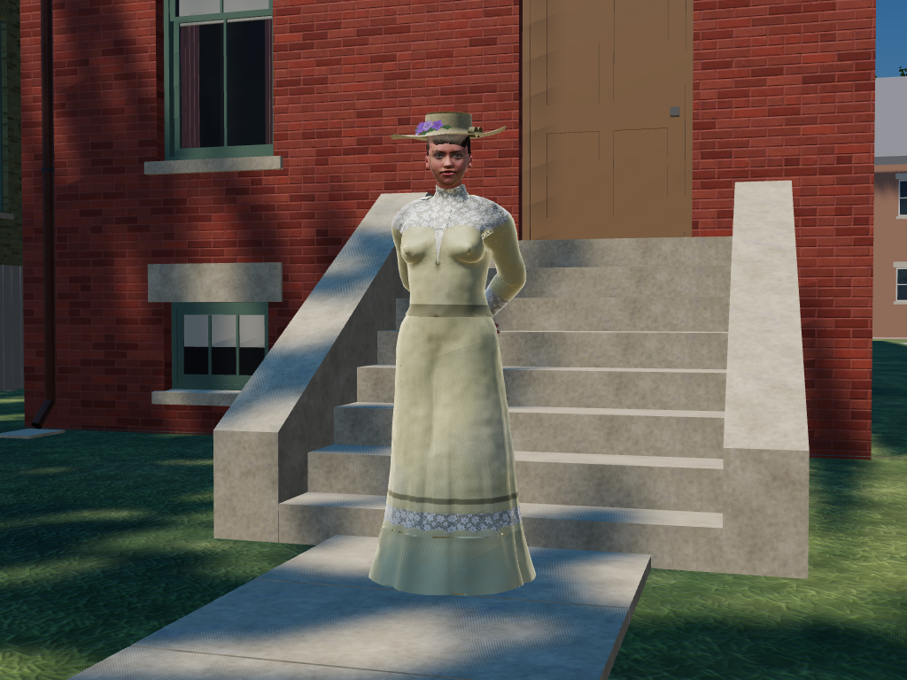

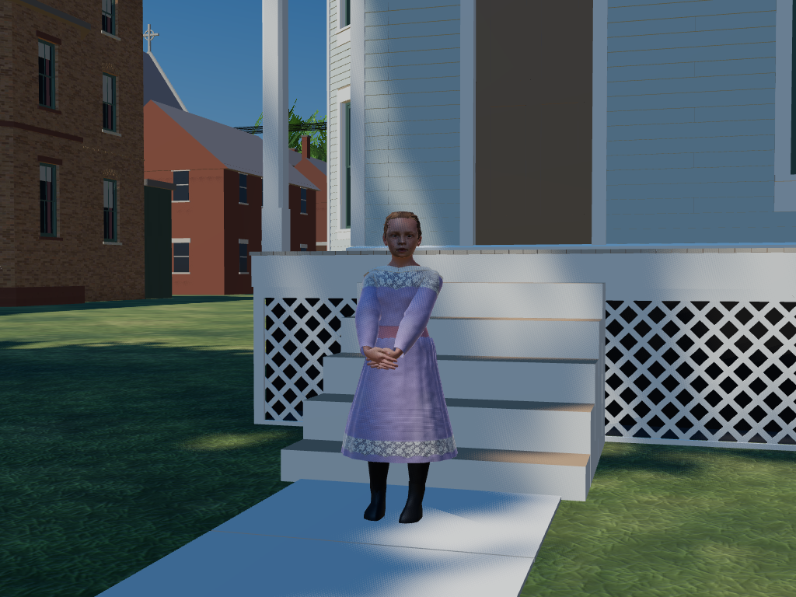

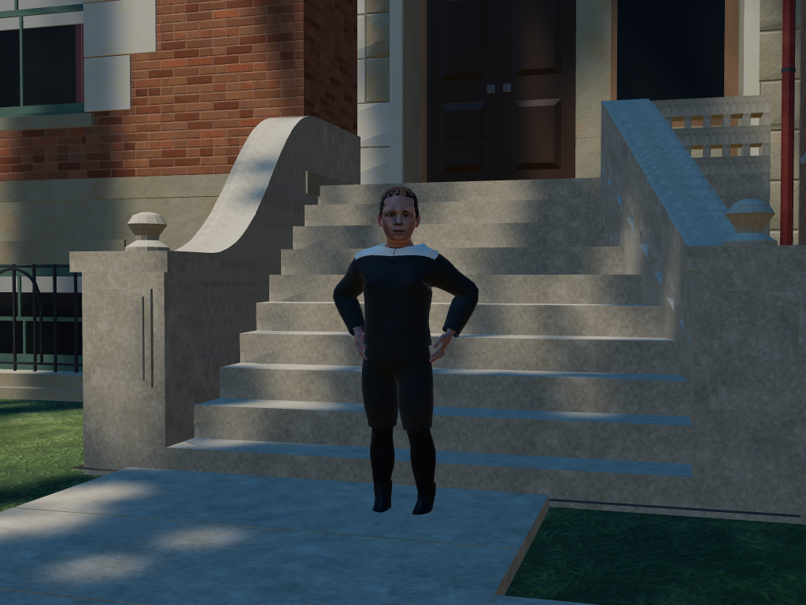

[Earlier native gallery: 28 named residents, generic people and angled views](GALLERY-b085.md). Those captures are from source `b085e2e5b3`, before this surface correction; they are retained as explicitly dated baseline views. The earlier 0aa surface-review gallery is preserved at its [immutable evidence commit](https://github.com/kevinrhaas/chicago-evidence/blob/423162df0fa7d0211833b9b9d15b766c536212be/evidence/person-photo-deployment-T-3762/GALLERY.md).

[Approved fictional reference sheet](approved-reference-sheet.png) — input target, separate from these app captures.
