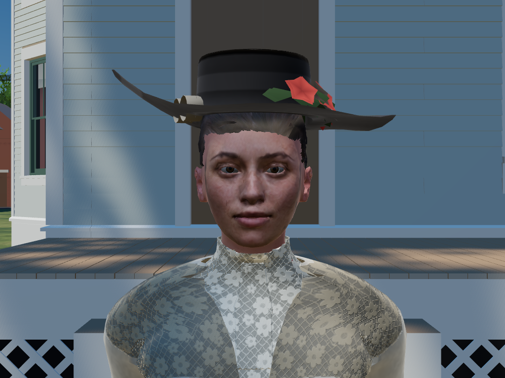
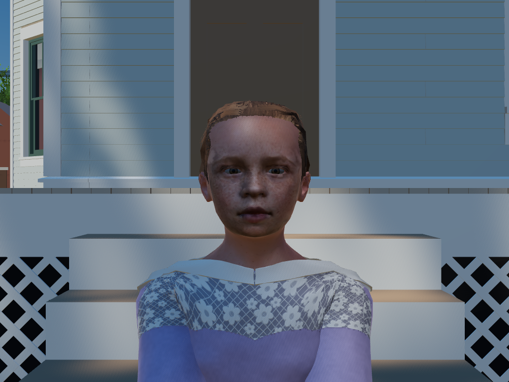
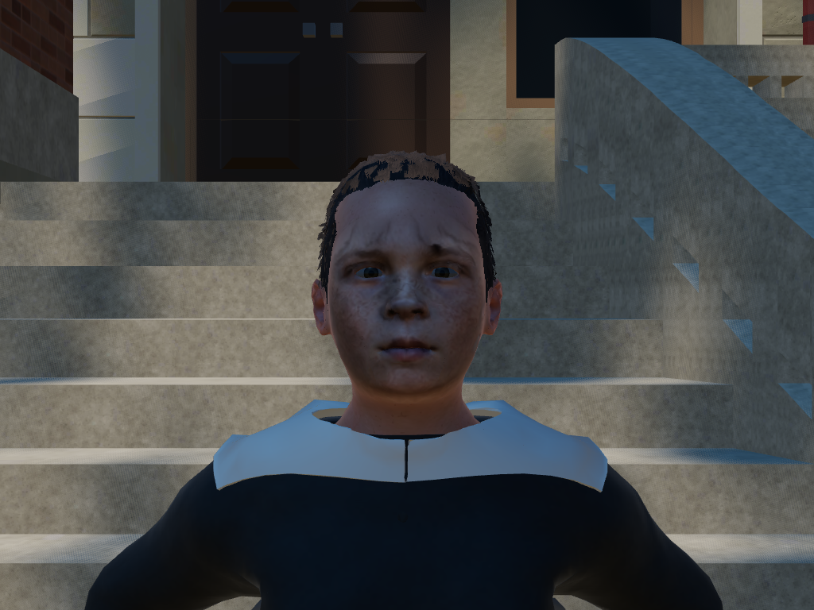
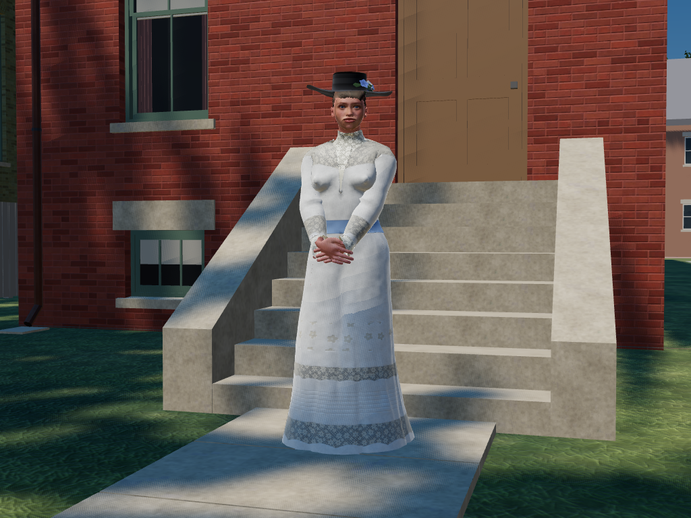

# Current people in the app — T-3762

Native app captures from frozen candidate tree `0aa14db492359069e453a68bae6e02b1db3aca0c`. **Dev deployment is pending verification.** The six front faces and four full figures use the published app’s assigned people, period clothes, materials and lighting. The camera is framed for review; no material injection or image generation was used. [Capture receipt](native-surface-review/receipt.json) binds the images to the served renderer and catalogs.

The close-up correction keeps the frontal cap above the skin and gives compressed hair meshes usable normals. Photo eye whites retain their measured tone. Children keep their existing head/body/eye geometry. These are software-rendered stills; real GPU FPS remains unmeasured.

## Walter C. Grey

Reconstructed library face; no individual archival likeness claimed

## Florence Grey

Reconstructed library face; no individual archival likeness claimed

## Elizabeth W. Grey

Reconstructed library face; no individual archival likeness claimed

## Henry W. Young

Reconstructed library face; no individual archival likeness claimed

## Dorothy Sterling

Owner-chosen period reference model

## Alice May Stirling

Owner-chosen period reference model

## Full figures

[Earlier native gallery: 28 named residents, generic people and angled views](GALLERY-b085.md). Those captures are from source `b085e2e5b3`, before this surface correction; they are retained as explicitly dated baseline views. The optional new angled-view loop reached actors that had streamed out, so no new oblique is claimed here.

[Approved fictional reference sheet](approved-reference-sheet.png) — input target, separate from these app captures.
