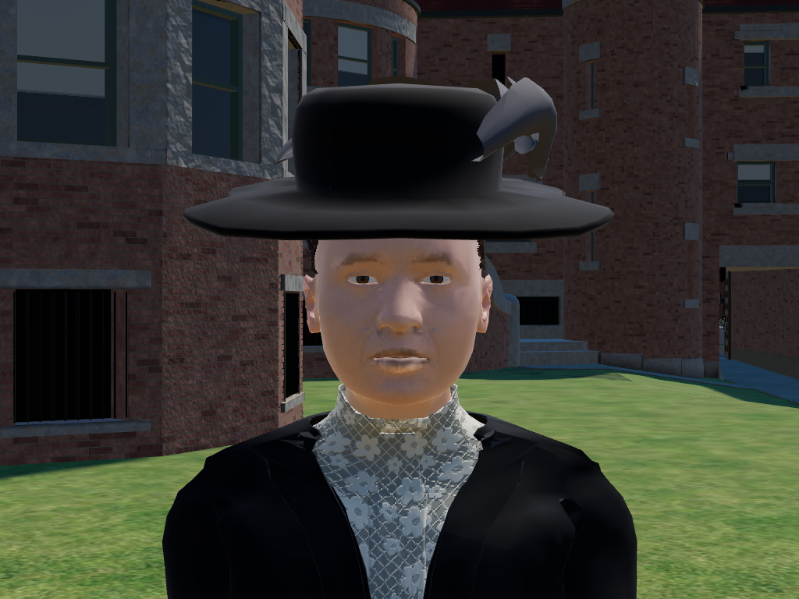
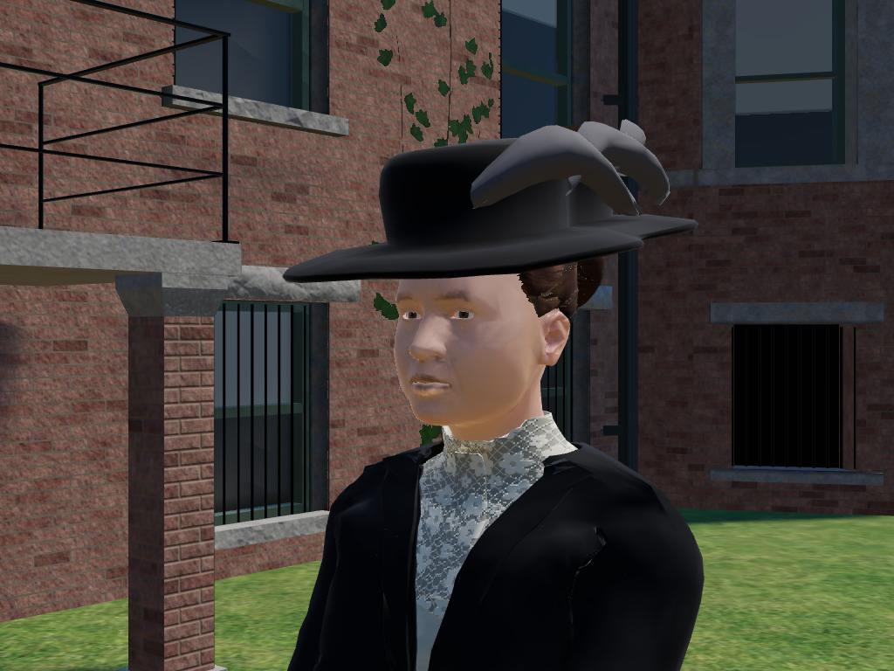
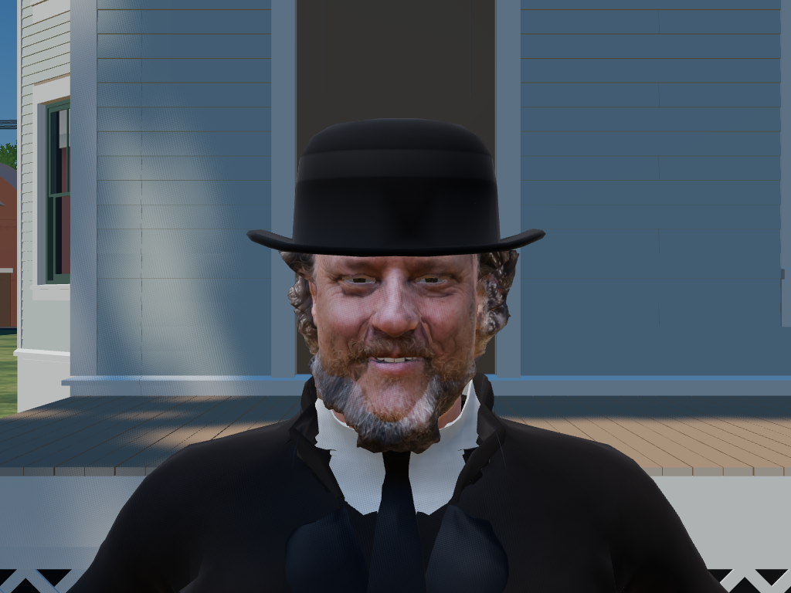
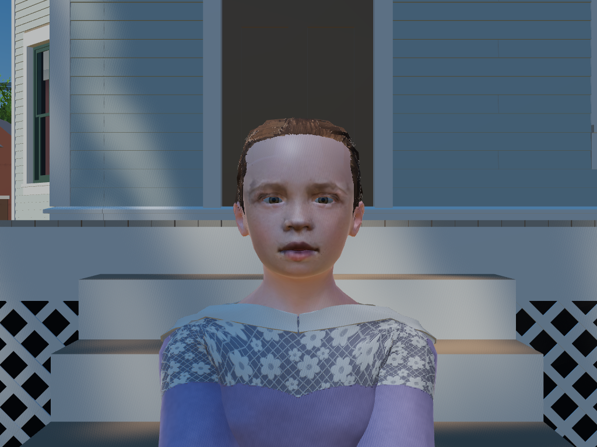

# Current people in the app — T-3762 / T-3792

Runtime capture tree: `da1a64359853462dfe3b9e389131c37b76d0c945`. Final source candidate: `0f58ca684bc4d821fb66946879d8089b96a5aa1e`. Later changes repair the clock-test harness and defer shader initialization for geometry-only tools. The [exact bridge](native-photo-hair-2026-11-27/natural-runtime-capture-bridge.json) verifies identical compiled shaders, catalog rendering fields and all 527 image/geometry files. **Local app review is complete; complete project qualification and dev deployment are pending.** The images use the published main app, its native people, period clothing, materials, lights and quality settings. The camera is framed for review and neighboring figures are hidden. There is no material injection or image generation in these app captures.

[Capture receipt](native-photo-hair-2026-11-27/receipt.json) binds all 18 views to the served modules and catalogs. Chromium uses SwiftShader here; these are appearance and resource-limit checks, not physical-GPU frame-rate evidence.

Dorothy alone has finer lip geometry and tighter painted lip registration. Frances receives a recorded skin-only scan-contrast calibration. The intended sky fill now reaches skin and eyes. Original source images, the other 410 fitted heads and all 7,610 person/year/body assignments are retained. The full Grey skin sheets remain their original mappings.

## Dorothy Sterling — owner-chosen period reference

| Previous app view, rejected for large lips | Current app view |
|---|---|
|  |  |

## Frances Glessner — own archival portrait

| Previous app view, rejected for dark mottled skin | Current app view |
|---|---|
|  |  |

The native Find/outing action changes her position and heading between captures; the metadata records each pose. The lighting-binding diagnosis is separate from these appearance views.

## Alice May Stirling — owner-chosen period reference

## Original Grey mappings — front views

| Sarah Grey | William L. Grey |
|---|---|
|  |  |

[Sarah side view](native-photo-hair-2026-11-27/sarah-balanced-oblique-in-app-face.png). The original owner-chosen full skins and fitted heads are retained; the photographic source contains William’s narrow smiling eye openings.

## Elizabeth W. Grey — same child face in both tiers

| Balanced | Light |
|---|---|
|  |  |

| Balanced side | Light side |
|---|---|
|  |  |

Native cap diagnostics sample 407/408 vertices with no inward intersections and a minimum clearance above 2.5 mm. Her original head, eyes and proportions remain unchanged. Light adds no near-hair layers or motion.

## Florence Grey — generic photographic face and scalable hair

| Full | Balanced | Light |
|---|---|---|
|  |  |  |

| Full side | Balanced side | Light side |
|---|---|---|
|  |  |  |

The shared Full/Balanced limits include all optional near scalp and facial cards. The reviewed bun adds 23,762 triangles in Full and 5,400 in Balanced; Light adds none. No new hair atlas or render pass is introduced.

## Walter C. Grey — generic photographic face

## Verification

[All-year identity check](native-photo-hair-2026-11-27/natural-all-year-identities.json) and [published module, atlas and population check](native-photo-hair-2026-11-27/natural-owner-corrected-local-payload-verification.json) pass. The 320 adult, 64 child and 27 named frontal bindings share the existing crowd sheets and one nearby resident-or-loading page. The two full Grey maps remain separate and unchanged. Physical-GPU crowd timing is still unmeasured.

The [two-pass photographic writer proof](native-photo-hair-2026-11-27/natural-photo-hair-writer-reproduction.json) is complete: all 536 output files reproduce byte for byte. The complete native project gate and all 30 published desktop/mobile scopes plus auxiliary checks must qualify the final source before dev delivery. Those remaining checks are not yet complete. [Source PR #2371](https://github.com/kevinrhaas/chicago/pull/2371) targets dev only.

[Earlier baseline gallery](GALLERY-baseline-f084.md) predates the owner-requested corrections and does not qualify this candidate.
