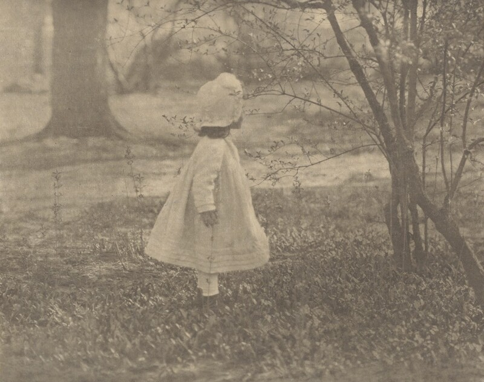
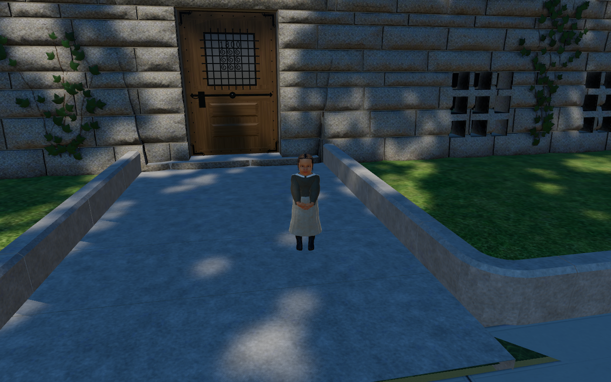
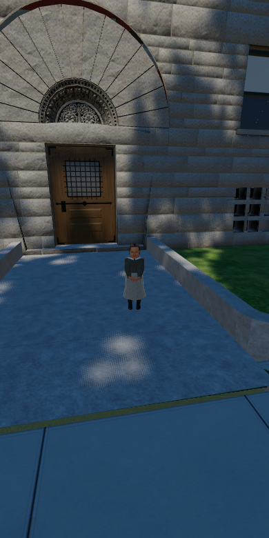

# Additional toddler clothing comparison

This reference was found after the five prototypes were built and presented for review. The models and original comparison sheets are unchanged.

[Alfred Stieglitz, *Spring—The Child*](https://www.nga.gov/artworks/35414-spring-child), photographed in 1901, printed 1903/1904. National Gallery of Art, Alfred Stieglitz Collection, accession 1949.3.263. The catalogue documents publication in *Camera Notes* in January 1902, establishing expired US copyright. [Download provenance and checksum](stieglitz-spring-child-1901-source.json).

The catalogue does not name the sitter or give an exact age. This is a photograph of another small child, not an identification or likeness of John Glessner and not an attested same-age portrait. It provides a closer small-child clothing comparison than the older girl on the original sheet. The photograph shows a light outer garment and bonnet; the prototype has a two-tone frock and no bonnet. Those differences remain visible and are not a photographic match.

The unchanged John Glessner, age 2, prototype at the fixed 3 m review distance:

| Published desktop | Published phone |
|---|---|
|  |  |

The original [near comparison](child_toddler_1904-near-comparison.jpg), [far comparison](child_toddler_1904-far-comparison.jpg), [walk samples](child_toddler_1904-motion.jpg) and build/runtime/hash records remain the evidence of the figure under review. This additional reference does not record approval or activate a resident.
