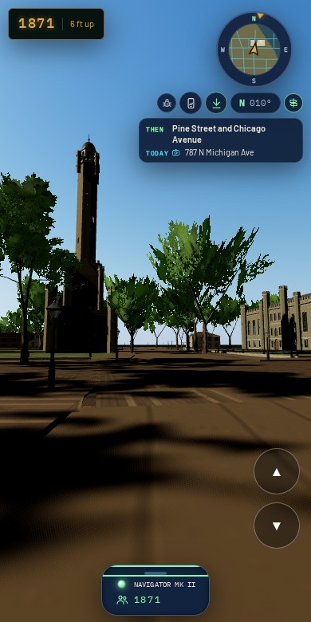
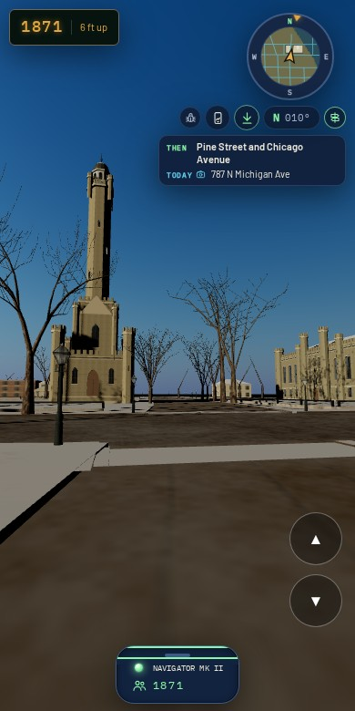

# Current source: calibrated pass, one inherited Native blocker, phone checks

Core source remains uncommitted on inspected Dev `67761214056dd916555d11cedf8c1a04c971b447`: complete 28-path tree `1552975ee6c9890da45bac239b9bd0133b0ad2ec`, app tree `4647f005d2a1af139a761640dbcbf926f6e09b28`. The complete patches and preparation proofs are in [the preceding snapshot](../original-current-source-and-seasons/).

**Calibrated desktop performance passed** on actual EPYC 9V74/four cores: Full 8989.6/15500 ms, Balanced 7612/11750 ms, Light 5585/7500 ms; zero page errors. Stock helpers, raster, samples, geometry and ceilings were unchanged. Run 46004512657, job 140525345767, artifact 15202344654, ZIP SHA256 `35dd871fcab28157b6c1ac81743e0ad558ccbe441337880961d3efaa542a35f4`. Source/host receipts, raw log, report and artifact are retained. This covers that exact source and calibrated profile; earlier EPYC 7763 failures remain retained and are not relabelled as fixed.

**Native did not pass.** Eight exact-source partitions passed. The complete final GitHub partition 8/8 failed exactly one of 182 selected steps: T-3645's reading-level test, with more than 40 retelling rows waiting for their keys to match recently rewritten house notes. This is the same failure already tracked as T-3789 on Dev; the feature changes neither `tools/test_reading_level.mjs` nor the authored reading corpus. All 28 before/after source hashes and complete trees matched. Every partition's full raw log, before/after source receipt, artifact and job metadata is retained in `core/`. No partial positivity supplies a complete Native pass.

While the last GitHub partition was queued, the same final partition ran locally. It reproduced the same reading failure, and its exact owned process group was intentionally stopped after 564.8 s, exit -15. Source and refs were unchanged. Its log, receipt and retirement reason are retained. It is not a completed Native partition. T-3789 was already claimed by the active owner run 45998146960; no other claim was taken and no threshold was raised. No new app commit, push or merge resulted.

**The current 1904 phone memory gate passed**: 523.8 MiB against 550 MiB, fresh stock published-source reading, 121.1 s, no snapshot. Its source-bound report/log/receipt are included. The preceding desktop recheck is still incomplete at its local time bound, not a memory pass or over-ceiling verdict. Full final-head CI memory coverage remains required.

**The current phone Water Tower view passed in all four seasons**, Light detail, fixed camera, zero page errors. All four audits handed off the same 3,543 context trees to the grown renderer, with zero portable solid context-tree meshes. The desktop Full four-season views are in the preceding snapshot. These are software-rendered diagnostics, not hardware FPS or historical planting/clearance proof.

The seasonal candidate's first calibration host was EPYC 9V45/four cores, whose stock profile has mobile limits only. It stopped at CPU eligibility before source application or timing; no performance verdict exists. The one eligibility-only retry request was rejected because the workflow was still running, so no retry was used. All nine seasonal Native jobs were still queued when the obsolete-base run was retired for the confirmed Dev blocker. None ran or supplied Native coverage. Fresh complete Native on the fixed Dev is required.

The complete gate remains binding before app authorship, followed by committed PR preflight and current-head CI/published smoke qualification before Dev merge. The temporary diagnostic PR must never merge. No heap snapshot, temporary download URL, production change or assertion waiver is included.
