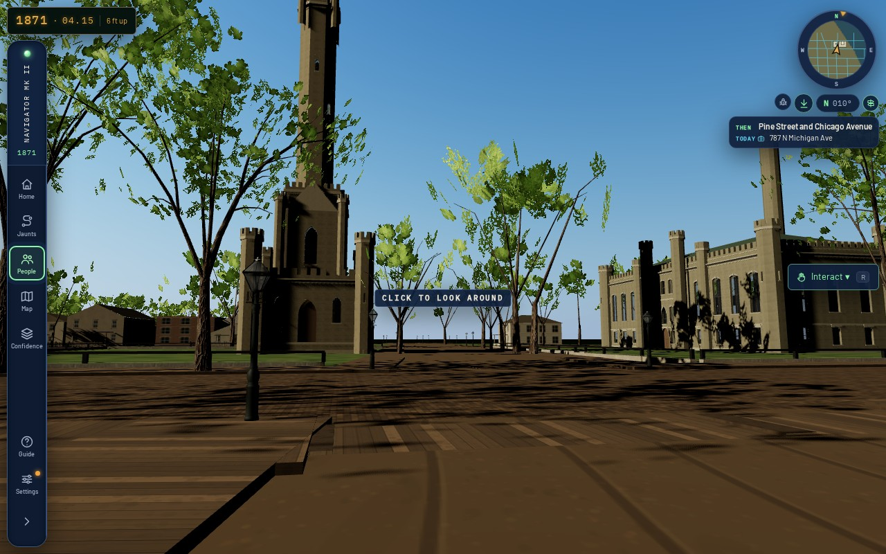
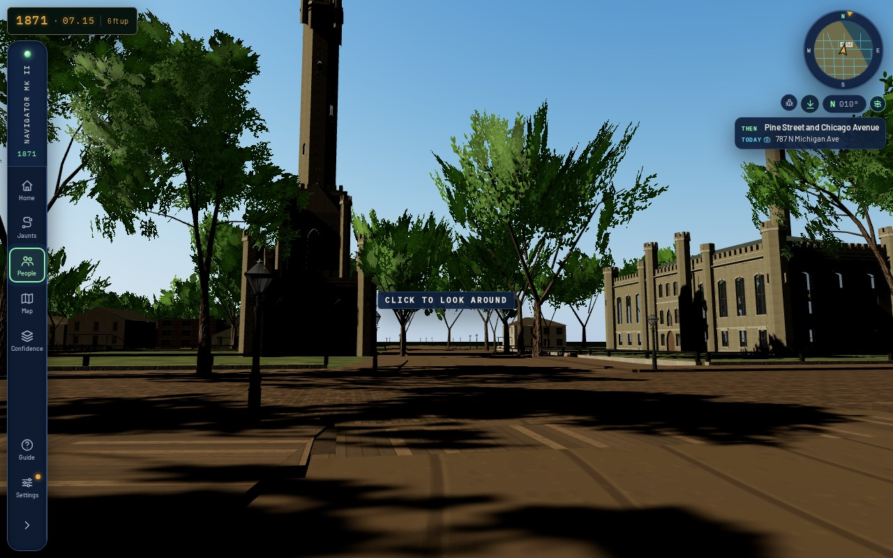
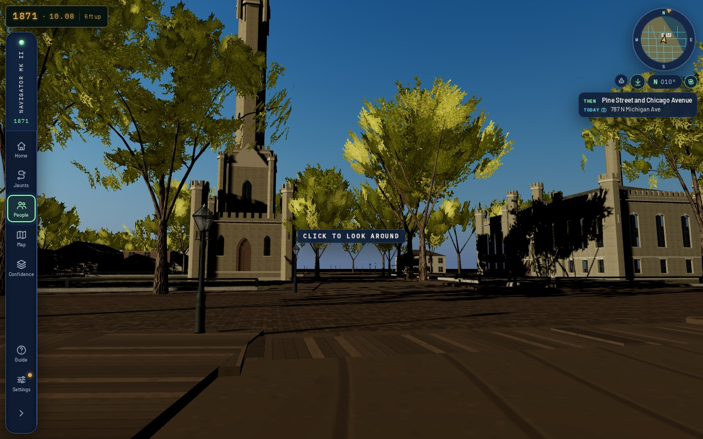
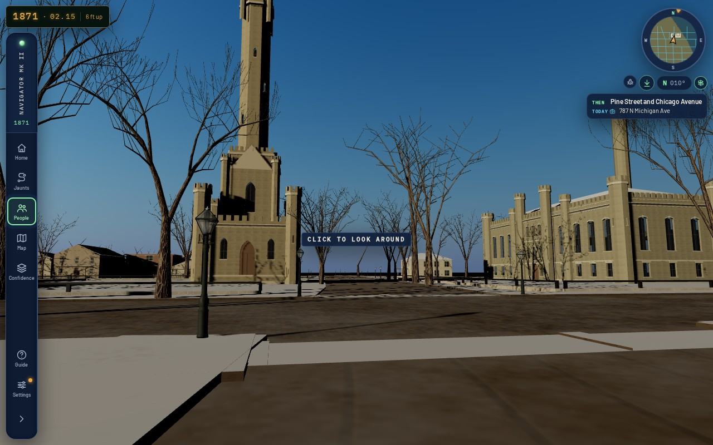

# Current Better Trees working source and all-season Water Tower views

This snapshot is explicitly **uncommitted working source**, not an app merge or a full-gate pass. Core is the complete 28-path feature on inspected Dev `67761214056dd916555d11cedf8c1a04c971b447`, tree `1552975ee6c9890da45bac239b9bd0133b0ad2ec`. The combined seasonal source adds the complete 31-path T-3748/T-3760 delta: 45 changed paths against that Dev, tree `79fabf2645b96ce9f3d460f70b5e79d0520b086e`, app tree `7029aee31c6137fd96f8377dfc00bc24c44e8b9d`. Its core parent is an explicitly uncommitted tree, not claimed merged. The source proofs and complete patches are retained.

Four fresh browser contracts passed: 1871 phone fresh-fall/Great Fire dates; desktop stored-winter/Great Fire dates and preference restoration; actual flora CPU/GPU wind/normal/season checks; and actual leaf/ivy masking, winter colour and directional/point shadow checks. The calendar captures from the date helper are header-only; the full-scene views below are a separate actual published capture.

The Full-detail Water Tower street camera was captured in spring, summer, fall and winter with zero page errors. All four readings hand off the same 3,543 recorded context trees to the grown renderer and find zero portable solid context-tree meshes. Winter shows bare deciduous wood. The stored JSON retains exact sun dates, camera, census and probe audit. These software-rendered images do not establish hardware FPS, historical planting positions or crown clearance. The full source retains existing reconstructed planting; an elm-like grown habit is a declared generic deciduous proxy.

The fresh 1904 desktop stock memory recheck is **incomplete**: its local 590-second bound was reached, exit 124, before any total reading or JSON report. Its raw log and source-bound receipt are retained. It is neither a memory pass nor an over-ceiling verdict. The complete final-head standard CI grid remains required.

Full exact-source Native and stock calibrated performance are pending in [Core run 46004512657](https://github.com/kevinrhaas/chicago/actions/runs/46004512657) and [seasonal run 46005863329](https://github.com/kevinrhaas/chicago/actions/runs/46005863329). The temporary diagnostic PR must never merge. Native runs before app authorship on complete frozen source; every partition must retain its full positive footer and before/after source receipts. Final committed PR preflight, current-Dev integration and all fresh actual-head CI/smoke bodies remain required before either app PR merges.

The included unmodified-Dev baseline is a different source and CPU: EPYC 9V74/four cores, Full 8795/15500, Balanced 7652.3/11750, Light 5559/7500 ms. It is a counterfactual, not feature qualification and not clearance of the earlier EPYC 7763 failures. Rejected leaf/shared guards and draw-order, fused-light and fixed-dielectric experiments are absent from the current app source. Earlier failed and incomplete gate evidence remains immutable in the sibling evidence folders. No heap snapshot or temporary download URL is included.
